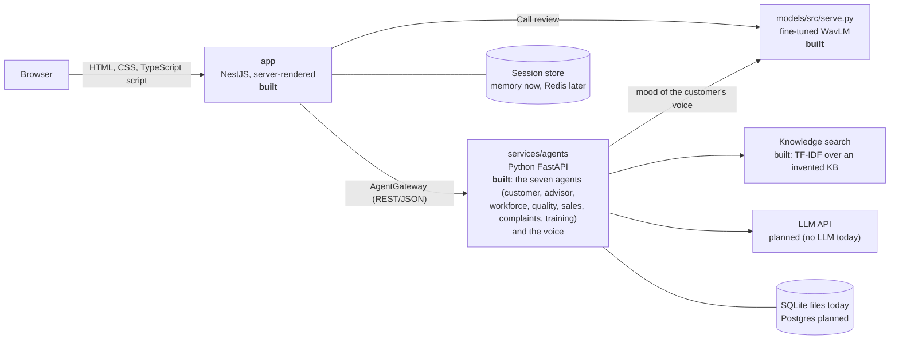

# Architecture

What exists today is marked **built**. Everything else is the recommended next step, in priority order.
The agents themselves are documented one by one in [`docs/agents/`](docs/agents/README.md) (what each does, formulas, data, endpoints, tests, limits).

## The shape

The web app never contains machine-learning code. It asks the **AgentGateway** (`app/src/agents`) for data, and
the gateway is either `MockAgentGateway` (fake data, default) or `HttpAgentGateway` (`AGENTS_MODE=http`, calls Python).
Replacing mock data with a real agent therefore changes one environment variable, not the pages.

## Decisions and why

| Decision | Why it is the efficient choice here |
|---|---|
| **One monorepo, four top-level folders**: `app` (deployed web), `models` (trained files the app loads), `notebooks` and `datasets` (local only, pushed empty); the Python agents live in `services/agents` next to them | One pull request can change the page, the gateway and the agent together. A student team of 4 to 8 does not need several repositories. Data and notebooks stay off GitHub (size, licences). |
| **NestJS as a thin web layer (BFF)**, pages rendered on the server | Fast first paint, no client framework to maintain, the strict CSP (no inline scripts) stays easy to keep. All pages load their agents in parallel (`Promise.all`), so a page waits for the slowest agent, not the sum. |
| **Python for agents**, separate process | The ML libraries (PyTorch, scikit-learn, transformers) live in Python. A separate service can be restarted, scaled and given a GPU independently of the web app. |
| **One Python service with one router per agent** at first, split later | One deployment and one loaded copy of each model in memory. Split an agent out only when it needs different scaling (the emotion model on a GPU is the likely first one). |
| **Contract first**: FastAPI publishes OpenAPI, generate the TypeScript types into `app` (for example `openapi-typescript`) | Today the contract is a table in `app/README.md`; a generated type makes drift a compile error instead of a runtime bug. Do this when the first real agent exists. |
| **Datasets are not in git; trained models live in `models/`** | Audio and embeddings are gigabytes and carry licences. Model files are small enough to track (GitHub limit: 100 MB, use Git LFS above that) with a small `.json` note: dataset, notebook version, metrics, date. |
| **Notebooks for research, plain modules for serving** | Move `predict_mood` out of the notebook into `services/agents/emotion.py` once the numbers are final. The notebook stays as the record of how the model was made. |

## Performance: where the time actually goes

1. **WavLM on a CPU is the bottleneck** (it is why embedding the 8,500 clips takes hours). In order of payoff:
   1. Use the GPU (the RTX 4060: install the CUDA build of PyTorch). Minutes instead of hours, and it enables fine-tuning.
   2. Cache embeddings by audio hash (the notebook already caches in chunks).
   3. Score recorded calls **offline** (a queue, for example Redis + RQ, or FastAPI background tasks) instead of inside a page request. The Quality Analyst does not need an answer in 100 ms.
   4. Only embed speech segments (voice activity detection), and quantise the model (ONNX int8) if CPU serving is unavoidable.
2. **The interactive agents need no audio model.** The client simulator, advisor and workforce twin are rules, retrieval and forecasting: keep them fast and independent of the emotion model.
3. **Web**: compression, content-hashed static files cached for 7 days, and a 30 s cache of read-only agent data are in place. Add Redis for sessions only when you run more than one web instance.

## Security (already done, keep it)

Strict CSP, CSRF token on every POST, role checks in one guard, lockout after 5 failed logins, session id renewed at
sign-in, secrets only from environment variables. Before a real deployment: replace the shared demo password with
real sign-in (OIDC, for example Keycloak or Microsoft Entra), and never commit `.env` files.

## Quality gates

* CI (`.github/workflows/ci.yml`): type-checked build and the unit/HTTP tests on every push and pull request.
* Browser tests (`app/e2e`, Playwright): run before a demo or release.
* Python agents: `pytest` in `services/agents` (205 tests), the same test cases run against the mock and the HTTP gateway so they cannot diverge; `models/tests` (4).
* Today in total: 372 automated tests (117 web, 46 browser, 205 Python, 4 models), and an axe accessibility audit of every page (`app/e2e/audit.mjs`). The facts behind every number of the presentation are in [`docs/PRESENTATION_FACTS.md`](docs/PRESENTATION_FACTS.md).
* Models: report actor-wise cross-validation with confidence intervals and a cross-dataset score (see `notebooks/`).

## Deployment path

1. Now: `docker build` in `app`, run on a laptop or one VM.
2. Today `start-all.bat` (see `start-all.ps1`) starts the agents, the emotion model and the web app on one Windows machine, and `start-all.bat -Clean` starts from the clean demo state. Still to do: a `docker-compose.yml` at the root (web + agents) so the whole thing starts with one command anywhere.
3. Production: the same two images on any container platform, a managed Postgres, Redis for sessions, and a health check on `/actuator/health`.

## Next steps, in order

1. Merge the local branches into `main` through pull requests, one topic each (sales, complaints, training, quality strengths, the automatic call), and tell the team about the contract additions in `app/src/agents/models.ts`.
2. Real sign-in before any outside user sees it (the demo password and in-memory sessions are for a local demo only).
3. `docker-compose.yml` (web + agents + emotion model); a real database instead of SQLite files.
4. An LLM-style judge next to the rules of the quality analyst, compared on the same calls; an advisor agent that reacts to the customer's mood (today a fixed routine).
5. Real labelled calls and the human-agreement study, then trials with real advisors and analysts. Learn the churn, chance-of-a-yes and escalation scores from real data (today hand-weighted).
