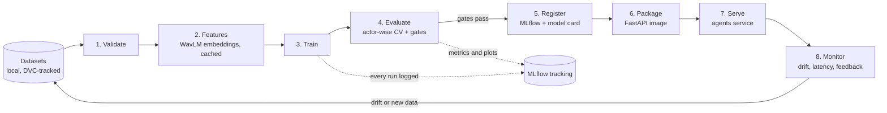

# MLOps pipeline for orqestra

Goal: anyone on the team can reproduce a model from a Git commit, see how it scored, and ship it without hand-copying
files. The stack is deliberately small (all free, all runnable on a laptop). Add heavier tools only when a real limit appears.

## The pipeline



| Stage | What it does | Tool | Fails the run when |
|---|---|---|---|
| 1. Validate | Every audio file decodes, sample rate and length are sane, labels parse, no silent or duplicate clips, actors never cross train/val/test | `pytest` + a `validate.py` script | any check fails (the first version of this found a silent CREMA-D clip) |
| 2. Features | Embeds each clip with a frozen WavLM and caches by file hash and model name | `src/features.py` | never; it is cached, so a rerun only embeds new files |
| 3. Train | Fits the classifier with the settings in `params.yaml`; seeds fixed | `src/train.py` | n/a |
| 4. Evaluate | Actor-wise 5-fold CV, 95% confidence interval over actors, cross-dataset score, per-emotion and per-sex/age results, label-shuffle leakage test | `src/evaluate.py` | a **gate** is missed (below) |
| 5. Register | Stores the model, its metrics, the data version and the Git commit; writes `model card.json` | MLflow Model Registry | n/a |
| 6. Package | Builds the serving image with the model baked in or mounted | Docker, GitHub Actions, GHCR | tests fail |
| 7. Serve | `POST /emotion/predict` in the Python agents service; the web app calls it through `HttpAgentGateway` | FastAPI | health check fails |
| 8. Monitor | Input drift, prediction mix, latency, errors; collects advisor corrections as new labels | Evidently + logs | alert thresholds |

## Quality gates (a model is promoted only if all pass)

| Gate | Threshold (starting point, tune with the team) |
|---|---|
| Within-dataset accuracy | not lower than the current registered model, with the confidence intervals compared |
| Cross-dataset accuracy | not lower than the current model by more than 2 points |
| Leakage test | shuffled-label accuracy within 2 points of chance (1/6) |
| Fairness | accuracy gap between sexes (and age bands) under 5 points |
| Calibration | expected calibration error under 0.05 |
| Serving | one-clip prediction equals the batch prediction on a fixed set of clips |

## Repository layout (keeps your four folders)

The `models/` folder becomes "the model project". Notebooks stay local and exploratory; **code that produces a shipped
model lives in git** under `models/`:

```
models/
  dvc.yaml            the pipeline (stages above)
  params.yaml         every setting in one file (layers, C, seed, split)
  src/                validate.py, features.py, train.py, evaluate.py, predict.py
  tests/              pytest: data checks, feature shapes, one-clip == batch
  registry/           model files + model card json (small ones; big ones go through DVC or a Release)
```

Datasets stay in `datasets/` and are tracked by DVC (pointers in git, audio on the shared remote or on each machine),
never committed. Notebooks in `notebooks/` stay untracked; when an experiment is worth keeping, move its logic into `src/`.

`models/dvc.yaml` (sketch):

```yaml
stages:
  validate:
    cmd: python src/validate.py --data ../datasets
    deps: [src/validate.py, ../datasets]
    outs: [reports/validation.json]
  features:
    cmd: python src/features.py --data ../datasets --model microsoft/wavlm-base-plus
    deps: [src/features.py, ../datasets, reports/validation.json]
    params: [features]
    outs: [cache/embeddings]
  train:
    cmd: python src/train.py
    deps: [src/train.py, cache/embeddings]
    params: [train]
    outs: [registry/emotion.joblib]
  evaluate:
    cmd: python src/evaluate.py
    deps: [src/evaluate.py, registry/emotion.joblib, cache/embeddings]
    metrics: [reports/metrics.json]
    plots: [reports/confusion.csv]
```

`dvc repro` runs only the stages whose inputs changed; `dvc exp run -S train.C=0.01` compares settings; `dvc metrics diff`
shows what a change did to the numbers.

## Experiment tracking and registry

* **MLflow** (`docker run -p 5000:5000 ghcr.io/mlflow/mlflow`): every run logs its parameters, metrics, plots, the Git
  commit and the DVC data hash. The **Model Registry** holds the stages `staging` and `production`; the serving image
  pulls the model marked `production`.
* **Model card** next to every registered model (`emotion_v3_full.json` is the first one): dataset, features, metrics,
  limits ("acted speech only"), date, who trained it.

## CI/CD (GitHub Actions)

| Workflow | Trigger | Does |
|---|---|---|
| `ci.yml` (exists) | push, pull request | build and test the web app |
| `ml-ci.yml` | pull request touching `models/` | install, `pytest`, run the pipeline on a **small fixed subset** (about 200 clips, minutes on CI), fail if gates are missed on it |
| `release.yml` | tag `v*` | build the web image and the model service image, push to GHCR, attach the model card to the Release |

Full training runs (hours) stay on a developer machine or one GPU box, not on free CI runners. They write to MLflow, and
the result is promoted by a human reviewing the gate report.

## Serving and monitoring

* **Service:** FastAPI in `services/agents`, one router per agent; the emotion router loads the registered model at
  start-up, returns the six probabilities plus the 0 to 100 mood. Same contract the web app already calls.
* **Latency budget:** WavLM on a CPU is slow, so score recorded calls in the background (queue) and keep interactive
  pages free of audio models. A GPU or an int8 ONNX export removes the limit later.
* **Monitor:** log every request's duration, audio length and predicted class. A weekly Evidently report compares live
  inputs with the training data (call audio is telephone-quality, the training sets are studio recordings, so expect
  drift from day one, and treat it as a signal to add 8 kHz augmentation and real labelled calls).
* **Feedback loop:** when an advisor or quality analyst corrects a predicted emotion, store it as a labelled example
  (with consent) in the next retraining set.

## Adoption order

1. Move the notebook logic into `models/src/` and add `params.yaml` and the `validate` and `evaluate` stages (**week 1**).
2. Add DVC for the data and `dvc repro`; add MLflow tracking (**week 1 to 2**).
3. Add `ml-ci.yml` on a small subset and the gates (**week 2**).
4. Build the FastAPI emotion endpoint and its image; wire `HttpAgentGateway` to it (**week 2 to 3**).
5. Add monitoring and the feedback loop (**after the first real users**).

Not needed yet: Airflow or Kubeflow (use `dvc repro` and GitHub Actions), a feature store, Kubernetes, a vector database.
Add them only when a concrete limit shows up.
