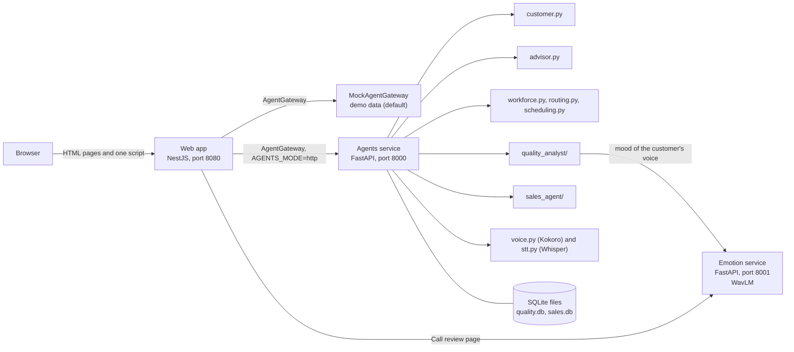

# orqestra: documentation of every agent

orqestra is a digital twin of a customer service center. Seven human roles each have an AI agent. This folder documents **what was actually built**, agent by agent, down to the formulas, the data, the endpoints, the screens, the tests and the limits. Everything here was checked against the code (as of 2026-10-22); where something is invented, simulated or only a demo, the document says so.

## The agents at a glance

| # | Agent | Persona (role in the app) | Status | Where the code lives | Document |
|---|---|---|---|---|---|
| 1 | **Customer simulator** | Yasmine Toumi, the client (`yasmine`) | Real | `services/agents/customer.py` (and a TypeScript twin in `app/src/pages/client-simulator.ts`) | [01-customer-simulator.md](01-customer-simulator.md) |
| 2 | **Customer advisor** | Karim Belhadj, the advisor (`karim`) | Real | `services/agents/advisor.py`, `knowledge/` | [02-customer-advisor.md](02-customer-advisor.md) |
| 3 | **Workforce manager** | Sana Gharbi, workforce (`sana`) | Real (forecast, simulation, routing, breaks) | `workforce.py`, `routing.py`, `scheduling.py` | [03-workforce-manager.md](03-workforce-manager.md) |
| 4 | **Quality analyst** | Nour Chaabane, quality (`nour`) | Real | `services/agents/quality_analyst/` | [04-quality-analyst.md](04-quality-analyst.md) |
| 5 | **Sales agent** | Leila Mansour, sales (`leila`) | Real | `services/agents/sales_agent/` | [05-sales-agent.md](05-sales-agent.md) |
| 6 | **Training agent** (Scenario Generation) | Rim Ayari (`rim`) | Real (by Selim Selmi) | `services/agents/scenario_gen/` | [06-training-and-complaints.md](06-training-and-complaints.md) |
| 7 | **Complaint agent** | Amine Jebali (`amine`) | Demo data only | `app/src/agents/mock.gateway.ts` | [06-training-and-complaints.md](06-training-and-complaints.md) |
| shared | **Voice** (speech out and in) | used by agents 1, 2, 4 | Real | `voice.py`, `stt.py` | [07-voice.md](07-voice.md) |
| shared | **Emotion model** | used by the Call review page and agent 4 | Real | `models/` | [08-emotion-model.md](08-emotion-model.md) |
| platform | **Web app and gateway** | all roles | Real | `app/` | [09-web-app-and-gateway.md](09-web-app-and-gateway.md) |

"Real" means the agent runs in the Python service (or the model service) and the web app calls it; "demo" means the web app serves fixed, invented data behind the same gateway so the page can be shown. The ideation phase named the Training lead's agent *Scenario Generation* and the Workforce manager's agent *(RL)*; the routing agent was built as a local search, not reinforcement learning, and the document says why.

## How it fits together



* The web app never contains machine learning. It asks one interface, the **AgentGateway**, for data. With `AGENTS_MODE` unset it gets demo data (`MockAgentGateway`); with `AGENTS_MODE=http` the `HttpAgentGateway` calls the Python service for every agent that exists there and keeps demo data for the rest. Replacing a demo agent by a real one is therefore one environment variable, not a page change.
* The Python service (`services/agents`, port 8000) holds all the real agents. The emotion model runs as its own service (`models/src/serve.py`, port 8001) because it needs the GPU and a different life cycle.
* Everything is local: no agent calls an outside API. Speech models and the embedding model run offline from files already on the machine.

## What every agent document contains

1. **Purpose and persona**: who it serves, what the ideation promised.
2. **Status**: real or demo, and what is simulated.
3. **How it works**: the algorithm, formulas and constants, in plain words.
4. **Data**: where each number comes from (and what is invented).
5. **API**: every endpoint with its inputs and outputs.
6. **In the web app**: pages, roles, buttons and what they do.
7. **Explainability**: how the agent shows why it answered what it answered.
8. **Tests**: what is checked, and how many tests.
9. **Honest limits**: what it cannot do, and what would replace the weak parts.
10. **Files** and **how to try it**.

## Run everything (Windows, from the repository root)

```powershell
# 1. the agents (port 8000)
Start-Process "..\venv\Scripts\python.exe" -ArgumentList '-m','uvicorn','main:app','--port','8000' -WorkingDirectory "services\agents" -WindowStyle Hidden
# 2. the emotion model (port 8001, needs the GPU or is slow)
Start-Process "..\venv\Scripts\python.exe" -ArgumentList '-m','uvicorn','serve:app','--app-dir','models/src','--port','8001' -WindowStyle Hidden
# 3. the web app (port 8080)
cd app; npm run build
$env:CALLVERSE_DEMO_PASSWORD='demo-password-123'; $env:CALLVERSE_COOKIE_SECURE='false'; $env:AGENTS_MODE='http'; node dist/main.js
```

Open http://localhost:8080. Every account uses the demo password: `yasmine` (client), `karim` (advisor), `sana` (workforce), `nour` (quality), `leila` (sales), `rim` (training), `amine` (complaints), `admin` (sees everything). The first start of the agents service takes about a minute (it loads the voice, speech and embedding models in the background).

## Settings (environment variables)

| Variable | Used by | Meaning | Default |
|---|---|---|---|
| `AGENTS_MODE` | web app | `http` calls the Python agents, anything else serves demo data | demo |
| `CALLVERSE_AGENTS_URL` | web app | where the agents service listens | `http://localhost:8000` |
| `CALLVERSE_EMOTION_URL` | web app (Call review page) | where the emotion service listens | `http://localhost:8001` |
| `CALLVERSE_DEMO_PASSWORD` | web app | password of the demo accounts (12 characters or more) | required |
| `CALLVERSE_COOKIE_SECURE` | web app | `false` only for plain `http://localhost` | secure |
| `PORT`, `SESSION_SECRET` | web app | port, session signing secret (random at each start if unset) | 8080 |
| `EMOTION_URL` | agents (recording review) | emotion service seen from the agents | `http://localhost:8001` |
| `EMOTION_WEIGHTS` | emotion service | weights file | `models/registry/emotion_wavlm_ft_full_aug2.pt` |
| `QUALITY_DB`, `SALES_DB` | agents | SQLite files | `services/agents/data/quality.db`, `sales.db` |
| `QUALITY_SEMANTIC` | quality analyst | `0` turns the semantic second opinion off | on when the model is cached |
| `QUALITY_EMBEDDER` | quality analyst | embedding model | `sentence-transformers/all-MiniLM-L6-v2` |
| `QUALITY_EVAL_FINAL` | quality analyst | `0` hides the final test calls while developing | on |
| `VOICES_DIR`, `VOICE_THREADS` | voice | Kokoro model folder, CPU threads | `models/voices`, 4 |
| `STT_MODEL` | speech to text | Whisper model | `openai/whisper-base.en` |
| `CALLVERSE_DATA` | model training | folder with CREMA-D and RAVDESS | `datasets/` |

## Tests, in numbers (2026-10-22)

| Suite | Command | Count | What it covers |
|---|---|---|---|
| Agents (Python) | `cd services/agents; pytest -q` | 177 | customer parity and endpoints, advisor, workforce, routing, breaks, voice, quality analyst (rules, store, XAI, labelling, robustness), sales agent |
| Emotion explanation (Python) | `pytest -q models/tests` | 4 | the occlusion map, with a fake model |
| Web app (Node) | `cd app; npm test` | 95 | pages, roles, CSRF, security headers, gateway mapping, each agent's routes |
| Browser (Playwright) | `cd app/e2e; npm test` | 40 | the real app against the real agents, in Edge |
| Accessibility | `cd app/e2e; npm run audit` | the app's pages, light and dark | axe-core: no violation |
| Continuous integration | GitHub Actions | web build and tests, agents tests (Python 3.11, without the heavy models) | every push and pull request |

## Honest summary of the limits

* **No language model anywhere.** The customer's words, the advisor's suggestions, the quality rules, the needs found by the sales agent are rules, patterns, retrieval and small models. Each document says where an LLM would plug in.
* **Invented or simulated data.** The knowledge base (12 passages), the offers, the five customers, the call history of the workforce agent, the 84 past calls of the quality analytics and the history behind "which offers convert" are invented or simulated. The emotion model is trained on acted speech.
* **Measured, not guaranteed.** The numbers quoted (F1 99 % on held-out calls, 74 % emotion accuracy) are measured on data we wrote or on acted corpora, so they are rough scores.
* **Not built**: the Complaint agent (demo only), the link from the Training agent's scenarios to the live call, reinforcement-learning routing, purchase and churn propensity, commercial simulation, real sign-in (a shared demo password is used).

## Related documents

[`../../README.md`](../../README.md) (run the web app, notebooks and datasets), [`../../ARCHITECTURE.md`](../../ARCHITECTURE.md) (decisions and the way forward), [`../../MLOPS.md`](../../MLOPS.md) (the model pipeline), [`../../DATA_COLLECTION.md`](../../DATA_COLLECTION.md) (collecting and labelling real calls), [`../../app/README.md`](../../app/README.md) (the agent API contract), [`../../services/agents/README.md`](../../services/agents/README.md) (running the agents), [`../../models/README.md`](../../models/README.md) (the emotion service).
